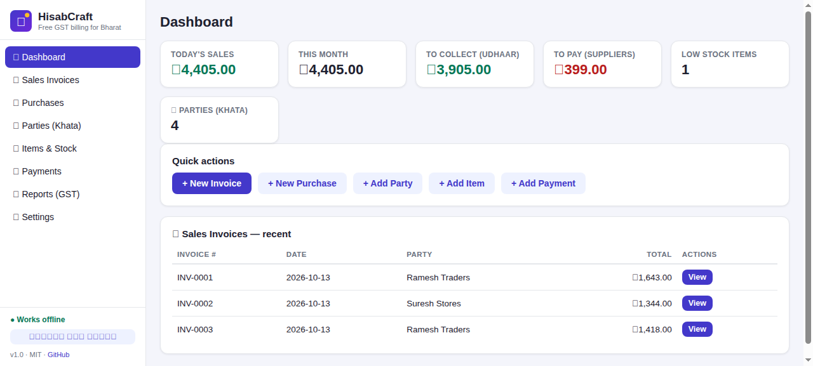
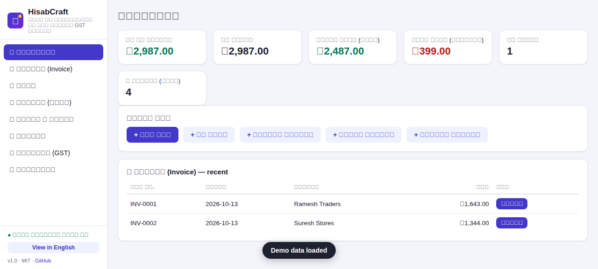

# HisabCraft

**Free, offline, open-source GST billing + khata + inventory for Bharat shops.**

Tally Prime costs ₹18,000+ per computer. Vyapar charges ₹3,000–8,000 a year in renewals.
Khatabook locks your ledger in their cloud. HisabCraft costs ₹0, works with no internet,
and your data never leaves your device.

Built with AI agents in pure Rust-grade discipline: **zero dependencies, zero build step,
zero tracking.** Vanilla JS + IndexedDB. MIT licensed.

> **Honest scorecard:** this is v1.0. It handles a small shop's daily billing, khata,
> stock and GST reports correctly — but it does NOT generate e-invoices (IRN) or e-way bills
> yet. Read [SCORECARD.md](SCORECARD.md) before you trust it with your books.

## Features

- **GST invoices** — intra-state (CGST+SGST) and inter-state (IGST) auto-detected from
  GSTIN state codes, discount before GST, rupee round-off, **amount in words**
  (lakh/crore system), HSN per line, printable tax invoice with declaration
- **Khata (ledger)** — party balances *derived* from invoices + payments, never stored,
  so deleting anything re-derives correctly. Per-party ledger with running balance
- **Inventory** — stock moves on every sale/purchase, low-stock alerts
- **GST reports** — GSTR-1 style B2B (invoice-wise) and B2C (rate-wise), month-wise
  sales, outstanding, CSV export
- **100% offline** — PWA with service worker. Installable. No account, no signup
- **English + Hindi UI** — one tap to switch
- **Your data** — JSON backup/restore, IndexedDB, lives in your browser

## Quick start

**Try it live:** https://sugamdeol.github.io/hisabcraft/

**Run locally** (no install needed):
```bash
# either open index.html directly, or:
python3 -m http.server 8000
# → http://localhost:8000
```

**Test the GST math:**
```bash
node tests/gst.test.mjs
```

**Load demo data:** Settings → "Load demo data" (checksum-valid GSTINs, a kirana store
with intra-state + inter-state invoices, a purchase, a payment).

## Screenshots

| Dashboard | Invoice (print view) | Hindi UI |
|---|---|---|
|  |  |  |

## The GST rules implemented

| Rule | Where |
|---|---|
| CGST + SGST = rate/2 each (intra-state) | `js/gst.js` `computeLine` |
| IGST = full rate (inter-state) | `js/gst.js` `computeLine` |
| Taxable = qty × rate − discount | `js/gst.js` `lineTaxable` |
| Invoice round-off to ₹1 | `js/gst.js` `computeInvoice` |
| GSTIN checksum (mod-36, official) | `js/gst.js` `validateGSTIN` |
| Amount in words (Indian system) | `js/gst.js` `numToWordsINR` |
| Place of supply = party GSTIN state vs your GSTIN state | `js/app.js` `docIsInterState` |

Every rule has an automated test. 18/18 passing:

```
✓ intra-state: 18% on ₹900 taxable → CGST ₹81 + SGST ₹81, total ₹1,062
✓ inter-state: 18% → IGST ₹162, CGST/SGST zero
✓ multi-line: per-line rounding, then invoice round-off to whole rupee
✓ valid GSTIN passes: 27AAPFU0939F1ZV
✓ corrupted checksum char fails
✓ makeGSTIN builds checksum-valid GSTIN from 14-char base
✓ formatINR uses Indian digit grouping
✓ 1,23,456.78 in words
  …13 more
```

## Architecture

```
index.html            app shell (no framework)
css/style.css         mobile-first, print stylesheet for invoices
js/gst.js             GST engine — PURE functions, zero deps, runs in node
js/db.js              IndexedDB wrapper + JSON backup/restore
js/i18n.js            English + Hindi dictionaries
js/app.js             router, 8 views, invoice editor, print, CSV
sw.js                 service worker (cache-first, offline)
tests/gst.test.mjs    the credibility layer — run with plain node
```

**Why derived balances?** A stored balance drifts the moment you delete an invoice.
HisabCraft recomputes every khata from the ledger entries, so it is always right.

**Built to be agent-friendly.** See [AGENTS.md](AGENTS.md) — the data model, the hard
rules, and how to add a view.

## What's NOT here yet (v1.0, honest)

- No e-invoice (IRN) / e-way bill generation
- No GSTR filing, no GST portal JSON export
- No barcode scan, no batch/expiry tracking
- No multi-user, no cloud sync, no mobile app store build
- No invoice editing (delete + re-create in v1)
- English + Hindi only

Full list with roadmap: [SCORECARD.md](SCORECARD.md) and [ROADMAP.md](ROADMAP.md).

## Disclaimer

HisabCraft is independent software. It is **not affiliated with GSTN, the Government of
India, Tally, or Vyapar**. GST rules change and implementations vary by state — verify
your returns with a chartered accountant before filing. GSTIN validation covers format
and checksum only, not whether a number is registered.

## License

MIT — do anything, including sell it. Please keep the attribution link in the sidebar.
